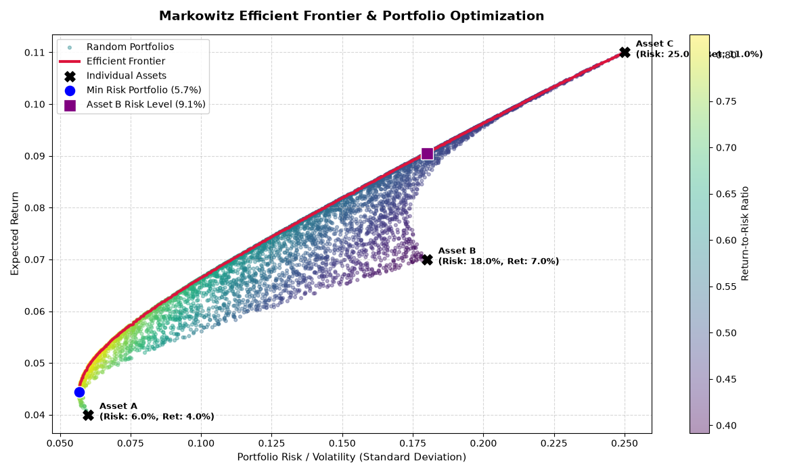

Markowitz Efficient Frontier & Portfolio Optimization

This repository contains a Python implementation of Modern Portfolio Theory (MPT), specifically calculating and visualizing the Markowitz Efficient Frontier for a portfolio of three assets using numpy and matplotlib.

Features:

1. Random Portfolio Simulation: Generates 5,000 diverse asset weight combinations using the Dirichlet distribution.
2. Risk & Return Modeling: Computes expected portfolio returns and portfolio volatility (standard deviation) using a custom covariance matrix.   
3. Efficient Frontier Extraction: Identifies the optimal subset of portfolios that maximize return for any given level of risk.
4. Interactive Visualizations: Color-codes random portfolios by their Return-to-Risk ratio and highlights key milestones like the Minimum Risk Portfolio. 

Interpretation & Summary of Results

Based on the generated script and visualization, here is a summary of the portfolio optimization analysis:
1. Individual Asset ProfilesThe analysis models three hypothetical assets with distinct risk-return characteristics:

Asset A: Low Risk (6.0%), Low Return (4.0%) — A conservative baseline asset.   

Asset B: Moderate Risk (18.0%), Moderate Return (7.0%). 

Asset C: High Risk (25.0%), High Return (11.0%) — An aggressive growth asset.  

2. The Efficient Frontier (Crimson Curve)The solid red line represents the Efficient Frontier. Portfolios on this curve are optimal because they offer the highest possible expected return for a specified level of risk, or conversely, the lowest risk for a given target return.   
Notice how the efficient frontier bows outward to the left of individual assets. This illustrates the power of diversification: combining assets with partial correlations (e.g., correlation of $0.5$ between Assets B and C) reduces overall portfolio variance below weighted averages.
3. Key Portfolio HighlightsMinimum Risk Portfolio (Blue Dot):
Located at the far left tip of the efficient frontier, this portfolio achieves the lowest possible volatility (~5.7% return-risk mix, lower than Asset A's standalone risk due to optimal weighting and diversification effects).   
Return-to-Risk Gradient (Viridis Colormap): The color map indicates the efficiency of each portfolio. Yellow-tinted points near the bottom-left/middle frontier signify superior return-to-risk ratios, whereas darker purple/blue points inside the cloud represent suboptimal allocations.  